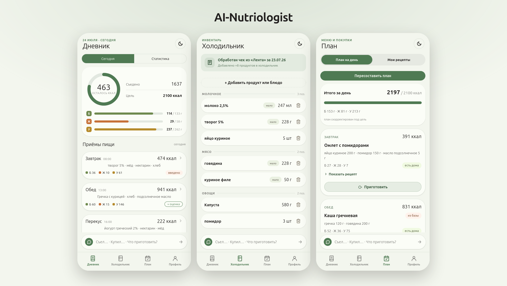

# AI-Nutriologist

[](https://github.com/Andrew82mm/AI-Nutriologist/actions/workflows/ci.yml)


**AI-Nutriologist** — персональный ИИ-агент для автоматического учёта питания и планирования рациона. Он знает, какие продукты есть у вас дома, что вы уже съели и как это соотносится с вашими целями по калориям и БЖУ. Вместо ручного заполнения таблиц и поиска продуктов в каталогах вы просто общаетесь с агентом обычным языком.



## Идея
Обычные счетчики калорий заставляют вручную вносить каждый продукт и каждый приём пищи — это скучно, долго и неудобно. Мой проект убирает эту рутину: он автоматически подтягивает данные из ваших электронных чеков и понимает фразы на естественном языке вроде «купил чизбургер в кфс». Вам остаётся только жить, а учёт ведётся сам.

## Как это работает

```
Чеки из почты  ─┐
Ручные правки  ─┤→  Холодильник (что есть дома)
                │
«Съел X» ───────┤→  Дневник питания  →  БЖУ и калории  →  Отчёты
                │
Ваши цели ──────┴→  План питания · список покупок · рецепты из того, что есть
```

1. **Знает, что у вас дома.** Все магазины присылают вам на почту электронные чеки (письма от ОФД) — агент сам их читает, распознаёт список покупок и пополняет «холодильник». Можно и вручную поправить: что-то купили без чека, что-то выбросили или закончилось.
2. **Знает, что вы съели.** Пишете в чат в свободной форме — «съел два яйца и кофе», — агент разбирает фразу, отдаёт вам на подтерждение в один клик и затем заносит в дневник.
3. **Считает БЖУ и калории.** Сопоставляет продукты со справочниками нутриентов; если данных нет — оценивает и честно помечает это как оценку, но вы сами можете поправить его если он ошибся и он навсегда запомнит эти данные.
4. **Помогает планировать.** Держит в уме ваши цели по калориям и БЖУ, подсказывает, что приготовить из имеющихся продуктов, и составляет список покупок с учётом того, что уже есть дома.

## Преимущества

- **Минимум ручной работы.** Чеки читаются автоматически, приёмы пищи вводятся обычным текстом — не нужно искать продукт в каталоге.
- **Полная картина.** Система понимает не только то, что вы съели, но и откуда этот продукт взялся и что осталось дома.
- **Приватность.** Все данные хранятся локально, на вашем устройстве, а не в чужом облаке.
- **Честные цифры.** Там, где есть точные данные из справочника, используются они; оценки от ИИ всегда помечены — вы видите, чему доверять.
- **Не привязан к одному ИИ-провайдеру.** Можно подключить облачную модель или запустить локальную — выбор за вами, меняется одной настройкой.

## Возможности приложения

Веб-интерфейс состоит из нескольких экранов:

- **Дневник** — приёмы пищи за день с подсчётом БЖУ и калорий относительно цели.
- **Статистика** — как питание выглядит в динамике.
- **Холодильник** — что и в каком количестве есть дома прямо сейчас.
- **План** — идеи меню и список покупок под ваши цели.
- **Профиль** — цели, ограничения и параметры тела.

## Как запустить

Нужен Python 3.12+ и Node.js (для веб-интерфейса).

```bash
# 1. Бэкенд
python3 -m venv .venv
.venv/bin/pip install -e ".[api]"
.venv/bin/python -m nutriologist.api        # http://127.0.0.1:8000

# 2. Фронтенд (в отдельном терминале)
cd web/app
npm install
npm run dev                                  # http://localhost:5173
```

Чтобы включить разбор незнакомых чеков и оценку БЖУ через ИИ, скопируйте `.env.example` в `.env` и укажите провайдера и ключ. Без этого приложение тоже работает — просто без ИИ-функций.


## Технологии

- **Бэкенд:** Python 3.12+, FastAPI, Uvicorn
- **Фронтенд:** React 18, Vite
- **Хранение:** SQLite (локально, на устройстве пользователя)
- **ИИ:** провайдер-агностичный слой — любой OpenAI-совместимый сервис (в том числе локальные модели)
- **Разбор чеков:** извлечение текста из PDF (poppler / `pdftotext`) + собственные правила, ИИ — только для незнакомых форматов
- **Качество:** pytest, GitHub Actions CI (Python 3.12 и 3.13)
